# Touchless Hospital Management System (Touchless HMS)
## Midterm Project Milestone & Conceptual Design Report

**Course:** Senior Graduation Project  
**Institution:** American University of the Middle East (AUM) — College of Engineering & Technology  
**Department:** Computer Engineering / Computer Science  
**Academic Year:** 2026  
**Project Title:** Touchless Hospital Management System (Touchless HMS)  
**Student Name:** Dana Alghareb  
**Supervising Faculty:** Graduation Project Committee  

---

## Executive Summary

The **Touchless Hospital Management System (Touchless HMS)** is a specialized, hygienic healthcare information management system designed to eliminate physical touchscreen and peripheral contact within clinical and public outpatient environments. In healthcare facilities, physical contact surfaces—such as self-service check-in kiosks, doctor workstation keyboards, and nurse telemetry monitors—serve as prominent vectors for Healthcare-Associated Infections (HAIs). By incorporating the **Leap Motion Controller (LM-010)** optical tracking system alongside modern computer vision and a robust dual-engine relational database backend, Touchless HMS enables patients, physicians, and nursing staff to navigate medical records, book specialist consultations, and acknowledge vital alarms entirely hands-free.

This report satisfies the requirements for the Senior Design Project Midterm Milestone. It delivers the complete **Conceptual and Project Design** (including functional modeling, structural modeling, behavioral modeling, and database modeling), documents all design enhancements and revisions made since the initial project proposal, and presents the current **Status of Software Development**, verifying that over 50% of the core software architecture is fully operational.

---

## Table of Contents

- [1 Conceptual Design](#1-conceptual-design)
  - [1.1 Functional Modeling](#11-functional-modeling)
    - [1.1.1 System Functional Scope & Core Processes](#111-system-functional-scope--core-processes)
    - [1.1.2 Use Case Modeling & Actor Descriptions](#112-use-case-modeling--actor-descriptions)
    - [1.1.3 Data Flow Modeling (Level-0 and Level-1 DFD)](#113-data-flow-modeling-level-0-and-level-1-dfd)
  - [1.2 Structural Modeling](#12-structural-modeling)
    - [1.2.1 Multi-Tier System Architecture](#121-multi-tier-system-architecture)
    - [1.2.2 UML Class Diagram & Entity Relationships](#122-uml-class-diagram--entity-relationships)
    - [1.2.3 Subsystem Component Architecture](#123-subsystem-component-architecture)
  - [1.3 Behavioral Modeling](#13-behavioral-modeling)
    - [1.3.1 Sequence Diagrams for Key System Workflows](#131-sequence-diagrams-for-key-system-workflows)
    - [1.3.2 Touchless Gesture Recognition State Machine](#132-touchless-gesture-recognition-state-machine)
    - [1.3.3 Clinical Appointment Lifecycle State Machine](#133-clinical-appointment-lifecycle-state-machine)
    - [1.3.4 Patient Kiosk Activity Diagram](#134-patient-kiosk-activity-diagram)
  - [1.4 Database Modeling](#14-database-modeling)
    - [1.4.1 Entity-Relationship (ER) Conceptual Diagram](#141-entity-relationship-er-conceptual-diagram)
    - [1.4.2 Relational Schema & Integrity Constraints](#142-relational-schema--integrity-constraints)
    - [1.4.3 Comprehensive Data Dictionary](#143-comprehensive-data-dictionary)
  - [1.5 Detailed Analysis of Project Design Revisions (Rubric 1.b)](#15-detailed-analysis-of-project-design-revisions-rubric-1b)
- [2 Status of Software Development](#2-status-of-software-development)
  - [2.1 Current Development Status & Milestone Achievement](#21-current-development-status--milestone-achievement)
  - [2.2 Detailed Breakdown of Implemented Features](#22-detailed-breakdown-of-implemented-features)
  - [2.3 Software Demonstrations & System Interface Walkthroughs](#23-software-demonstrations--system-interface-walkthroughs)
  - [2.4 Features Currently Under Active Development](#24-features-currently-under-active-development)
  - [2.5 Major Technical Issues & Challenges Encountered](#25-major-technical-issues--challenges-encountered)
  - [2.6 Remaining Work & Implementation Roadmap to Final Defense](#26-remaining-work--implementation-roadmap-to-final-defense)
- [References](#references)

---

# 1 Conceptual Design

## 1.1 Functional Modeling

Functional modeling defines what the Touchless Hospital Management System does by formalizing its operational processes, input boundaries, data transformations, and corresponding outputs. The functional domain of Touchless HMS centers on providing contactless, reliable, and auditable interactions across three primary user roles: **Patients**, **Physicians**, and **Nursing Staff**.

### 1.1.1 System Functional Scope & Core Processes

The functional scope encompasses four interconnected process domains:

1. **Contactless Biometric & Credentialed Access Control:**  
   * **Inputs:** Raw Leap Motion optical tracking stream (open palm hold event for 1.5 seconds) or conventional Civil ID / email credentials.
   * **Processing:** Hand posture validation, SHA-256 password hash comparison, role extraction (`patient`, `doctor`, `nurse`), and session token synthesis.
   * **Outputs:** Authenticated session state, user role permissions matrix, personalized clinical profile.

2. **Specialist Doctor Discovery & Hands-Free Appointment Booking:**  
   * **Inputs:** Touchless air-gesture selection (hover-dwell for 1.2s over department filter pills), keyword search strings, time-slot selection.
   * **Processing:** SQL relational multi-table JOIN across `departments`, `doctors`, and `users`, availability verification, constraint validation against scheduling conflicts.
   * **Outputs:** Real-time filtered physician cards with consultation fee, clinic room number, rating; persistent appointment record inserted into the database with `scheduled` status.

3. **Physician Clinical Encounter & Medical Record Management:**  
   * **Inputs:** Doctor authentication, touchless swipe gestures to cycle patient queue, air-pinch to inspect diagnostic imaging, clinical notes input, e-prescription form submission.
   * **Processing:** Retrieval of patient historical encounters, vitals telemetry rendering, insertion of pharmaceutical prescriptions linked to consultation ID with foreign key integrity.
   * **Outputs:** Real-time appointment timeline updates, persistent medication orders with dosage and duration, audit trail records.

4. **Nurse Ward Telemetry & Touchless Alarm Dismissal:**  
   * **Inputs:** Streaming biometric patient vitals (Heart Rate, Blood Pressure, SpO2, Temperature), contactless horizontal hand wave gesture over sterile zone sensor.
   * **Processing:** Threshold evaluation against critical physiological bounds, alarm event triggers, gesture acknowledgement filtering.
   * **Outputs:** Visual color-coded alarm state transitions (Red/Critical to Green/Normal), acknowledgement timestamp logging.

---

### 1.1.2 Use Case Modeling & Actor Descriptions

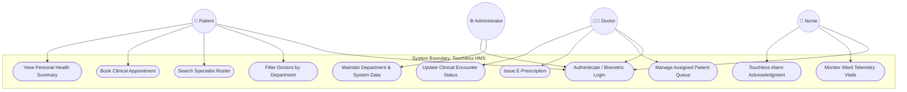

#### Detailed Use Case Specifications

* **Use Case UC-04: Book Clinical Appointment (Hands-Free)**
  * **Primary Actor:** Patient.
  * **Pre-conditions:** Patient is registered in the database; kiosk is connected to the optical sensor.
  * **Main Flow:**
    1. Patient hovers hand over the desired medical department pill (e.g., *Cardiology*).
    2. System executes dwell-timer animation (1.2 seconds) and triggers audio feedback frequency.
    3. System fetches specialist doctors belonging to the selected department via `GET api/doctors.php?department_id={id}`.
    4. Patient selects the physician card via optical push gesture.
    5. Booking modal opens; patient selects desired date, time slot, and submits appointment.
    6. System validates foreign keys (`patient_id`, `doctor_id`, `department_id`) and commits transaction.
    7. System renders animated confirmation and updates upcoming appointment widget.
  * **Post-conditions:** A persistent record is created in `appointments` table with `status = 'scheduled'`.

* **Use Case UC-07: Issue E-Prescription (Doctor Portal)**
  * **Primary Actor:** Doctor.
  * **Pre-conditions:** Doctor is authenticated; clinical encounter is open.
  * **Main Flow:**
    1. Doctor navigates to the *Rx & Prescriptions* tab.
    2. Doctor selects patient from active schedule list.
    3. Doctor enters medication name, dosage, frequency, and instructions.
    4. System validates inputs and transmits payload to `POST api/prescriptions.php`.
    5. Database commits prescription with foreign key links to `patient_id` and `doctor_id`.
    6. Success toast is displayed; prescription appears in patient’s digital health record.
  * **Post-conditions:** Prescription saved and visible immediately in patient's kiosk portal.

---

### 1.1.3 Data Flow Modeling (Level-0 and Level-1 DFD)

The data flow modeling details how data traverses physical boundaries, processing modules, and persistent storage.

#### Level-0 Context Data Flow Diagram

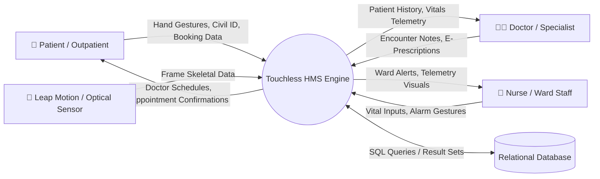

#### Level-1 Functional Data Flow Diagram

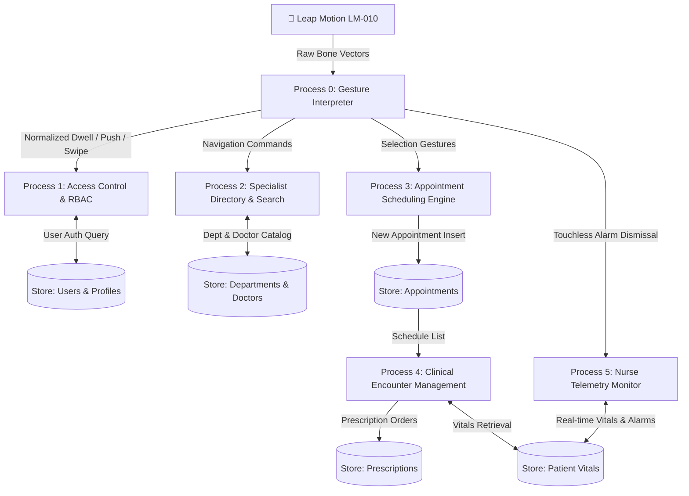

---

## 1.2 Structural Modeling

Structural modeling captures the static architectural organization of Touchless HMS, outlining its constituent tiers, components, interfaces, class hierarchies, and dependencies.

### 1.2.1 Multi-Tier System Architecture

Touchless HMS is organized into a clean **3-Tier Service-Oriented Architecture (SOA)** ensuring high separation of concerns, robust security boundaries, and modular maintainability:

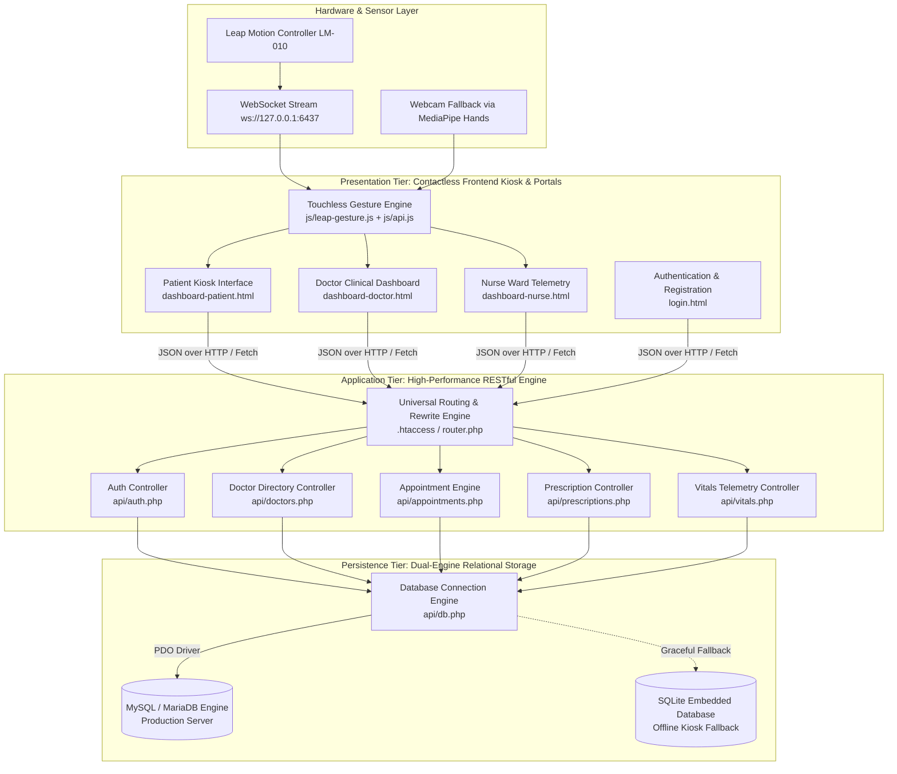

---

### 1.2.2 UML Class Diagram & Entity Relationships

The class structure defines the data attributes, operations, and relational multiplicity enforced throughout the application and persistence tiers:

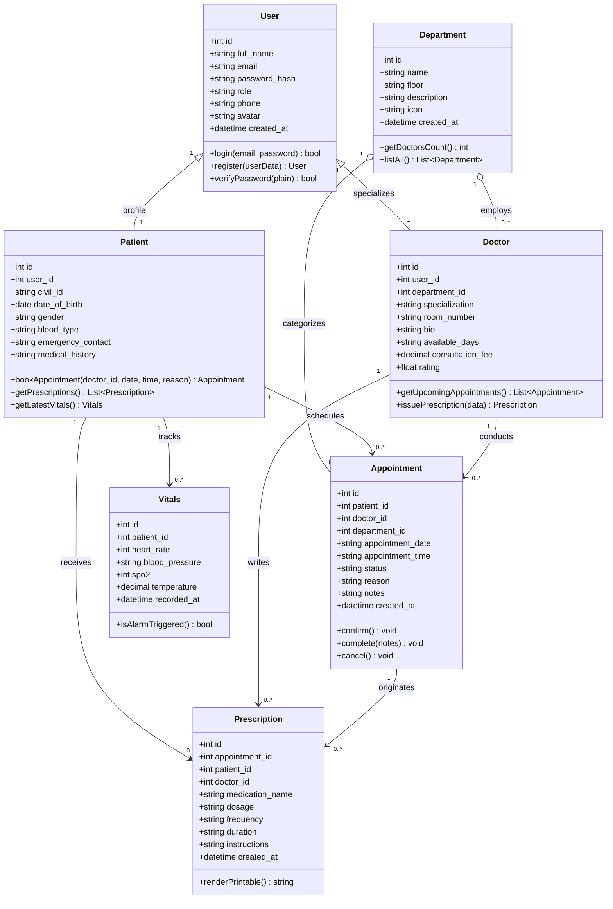

---

### 1.2.3 Subsystem Component Architecture

Touchless HMS is partitioned into five distinct software components:

1. **`TouchlessCore` (Client Gesture Subsystem):** Contains `leap-gesture.js`, `webcam-gesture.js`, and `gestures.js`. Responsible for opening WebSocket connections to the Leap daemon (`127.0.0.1:6437`), normalizing 3D Cartesian coordinates $(X, Y, Z)$, smoothing palm velocity, calculating pointer ray intersections with DOM target elements (`.gesture-target`), and rendering visual dwell ring animations.
2. **`AdaptiveApiClient` (`js/api.js`):** Client-side network abstraction layer. Detects execution context (Apache web root vs. nested subfolder vs. port 3000 Node server), maps clean REST endpoints (`/api/doctors`) to physical PHP scripts (`api/doctors.php`), and executes automatic fallback retries to eliminate 404 routing anomalies.
3. **`HttpRouterEngine` (`.htaccess` / `router.php`):** Server-level rewrite engine that guarantees URL routing transparency across Apache XAMPP, LAMP, and standalone PHP development servers.
4. **`ClinicalApiModule` (`api/*.php`):** Lightweight, stateless REST controllers written in PHP 8.2+. Enforces parameter validation, sanitizes inputs, interacts exclusively through parameterized PDO queries, and outputs standardized RFC-8259 JSON payloads.
5. **`DualEngineDataPersistence` (`api/db.php`):** Dual-tier connection manager. Evaluates local MySQL port 3306 availability. If accessible, connects to production MariaDB/MySQL database; if unavailable, seamlessly cascades to embedded SQLite database (`database/touchless_hms.db`) without service interruption or code modifications.

---

## 1.3 Behavioral Modeling

Behavioral modeling captures dynamic interaction patterns, time-sequenced communications, and state transitions that occur in response to user air gestures and clinical events.

### 1.3.1 Sequence Diagrams for Key System Workflows

#### Sequence 1: Contactless Patient Appointment Booking

The following sequence illustrates the complete end-to-end execution of a touchless booking transaction initiated from the physical kiosk:

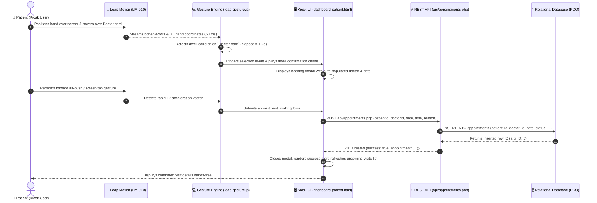

#### Sequence 2: Physician Clinical Encounter & E-Prescription Creation

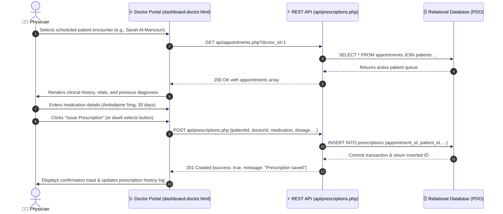

---

### 1.3.2 Touchless Gesture Recognition State Machine

The Leap Motion gesture recognition pipeline operates as a deterministic finite-state machine (FSM) that translates continuous spatial sensor input into discrete user interface commands:

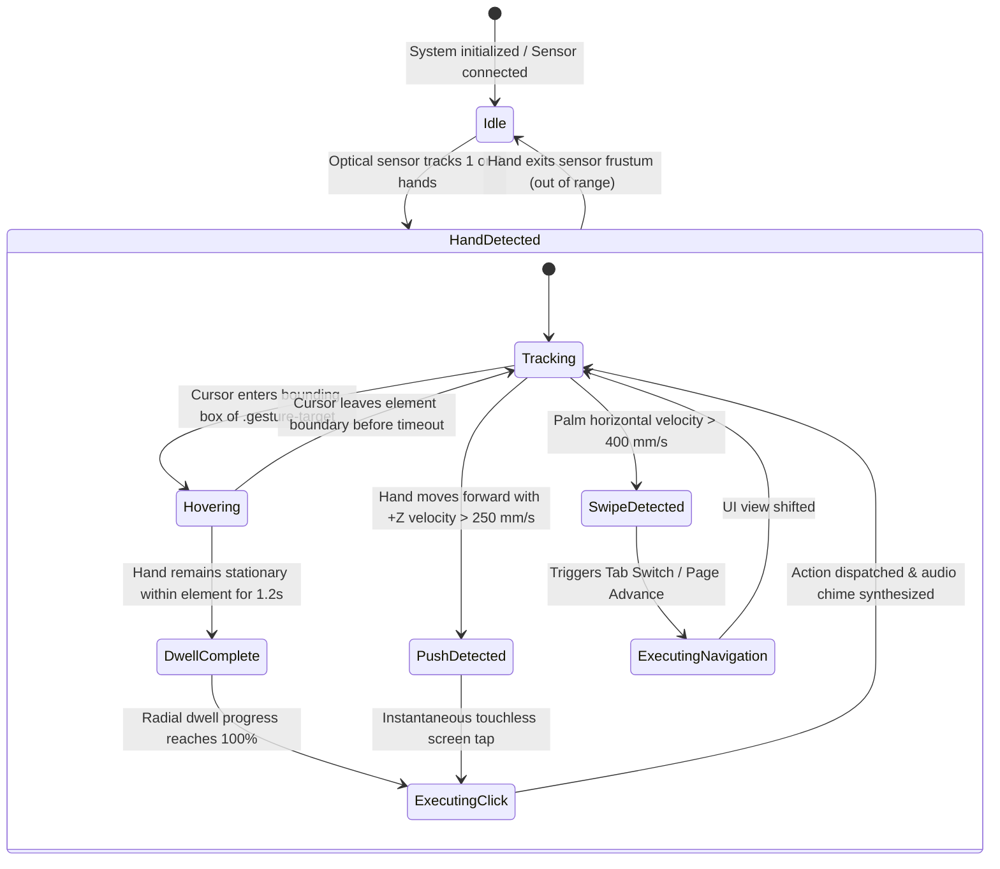

---

### 1.3.3 Clinical Appointment Lifecycle State Machine

Appointments within Touchless HMS transition through five strictly validated lifecycle states:

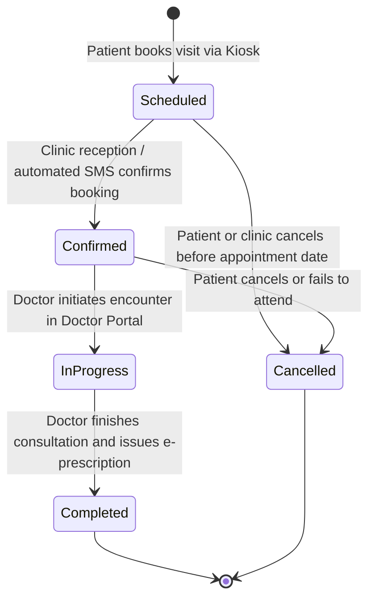

---

### 1.3.4 Patient Kiosk Activity Diagram

The flow of patient actions across the touchless kiosk is modeled in the activity diagram below:

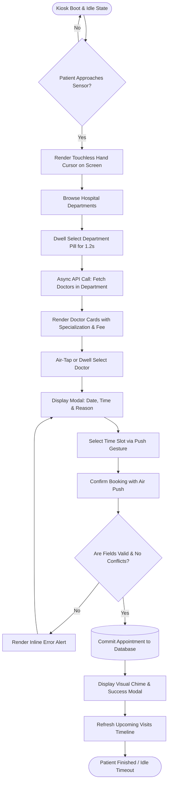

---

## 1.4 Database Modeling

Database modeling defines the relational architecture, referential integrity rules, primary-foreign key linkages, and normalization standards governing persistent data storage in Touchless HMS.

### 1.4.1 Entity-Relationship (ER) Conceptual Diagram

The relational architecture is in **Third Normal Form (3NF)**. Every table possesses an atomic primary key, and non-key attributes are fully and directly dependent solely upon the primary key:

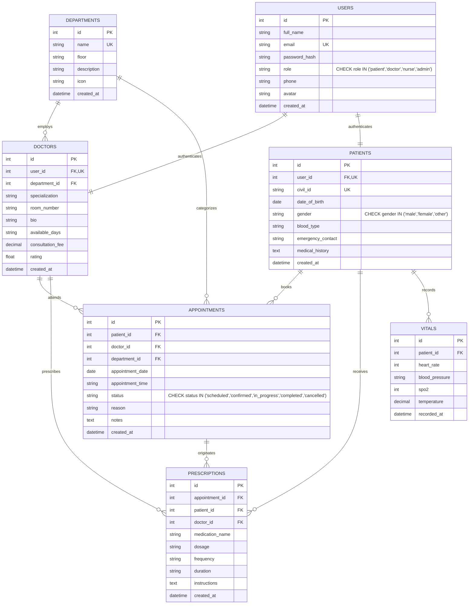

---

### 1.4.2 Relational Schema & Integrity Constraints

The relational schema translates the conceptual ER model into physical SQL DDL structures supported identically across **MySQL / MariaDB** and **SQLite3**:

```sql
-- 1. DEPARTMENTS TABLE
CREATE TABLE departments (
    id INT AUTO_INCREMENT PRIMARY KEY,
    name VARCHAR(100) NOT NULL UNIQUE,
    floor VARCHAR(50) NOT NULL,
    description TEXT,
    icon VARCHAR(20) DEFAULT '🏥',
    created_at TIMESTAMP DEFAULT CURRENT_TIMESTAMP
);

-- 2. USERS TABLE (Role-Based Authentication Core)
CREATE TABLE users (
    id INT AUTO_INCREMENT PRIMARY KEY,
    full_name VARCHAR(150) NOT NULL,
    email VARCHAR(150) NOT NULL UNIQUE,
    password_hash VARCHAR(255) NOT NULL,
    role ENUM('patient', 'doctor', 'nurse', 'admin') NOT NULL DEFAULT 'patient',
    phone VARCHAR(30),
    avatar VARCHAR(100) DEFAULT '👤',
    created_at TIMESTAMP DEFAULT CURRENT_TIMESTAMP
);

-- 3. DOCTORS TABLE
CREATE TABLE doctors (
    id INT AUTO_INCREMENT PRIMARY KEY,
    user_id INT NOT NULL UNIQUE,
    department_id INT NOT NULL,
    specialization VARCHAR(150) NOT NULL,
    room_number VARCHAR(50) NOT NULL,
    bio TEXT,
    available_days VARCHAR(100) DEFAULT 'Sun,Mon,Tue,Wed,Thu',
    consultation_fee DECIMAL(10,2) DEFAULT 30.00,
    rating DECIMAL(3,2) DEFAULT 4.90,
    created_at TIMESTAMP DEFAULT CURRENT_TIMESTAMP,
    FOREIGN KEY (user_id) REFERENCES users(id) ON DELETE CASCADE,
    FOREIGN KEY (department_id) REFERENCES departments(id) ON DELETE RESTRICT
);

-- 4. PATIENTS TABLE
CREATE TABLE patients (
    id INT AUTO_INCREMENT PRIMARY KEY,
    user_id INT NOT NULL UNIQUE,
    civil_id VARCHAR(12) UNIQUE,
    date_of_birth DATE,
    gender ENUM('male', 'female', 'other') DEFAULT 'other',
    blood_type VARCHAR(5) DEFAULT 'O+',
    emergency_contact VARCHAR(100),
    medical_history TEXT,
    created_at TIMESTAMP DEFAULT CURRENT_TIMESTAMP,
    FOREIGN KEY (user_id) REFERENCES users(id) ON DELETE CASCADE
);

-- 5. APPOINTMENTS TABLE (Central Transactional Linkage)
CREATE TABLE appointments (
    id INT AUTO_INCREMENT PRIMARY KEY,
    patient_id INT NOT NULL,
    doctor_id INT NOT NULL,
    department_id INT NOT NULL,
    appointment_date DATE NOT NULL,
    appointment_time VARCHAR(20) NOT NULL,
    status ENUM('scheduled', 'confirmed', 'in_progress', 'completed', 'cancelled') NOT NULL DEFAULT 'scheduled',
    reason VARCHAR(255) NOT NULL,
    notes TEXT,
    created_at TIMESTAMP DEFAULT CURRENT_TIMESTAMP,
    FOREIGN KEY (patient_id) REFERENCES patients(id) ON DELETE CASCADE,
    FOREIGN KEY (doctor_id) REFERENCES doctors(id) ON DELETE RESTRICT,
    FOREIGN KEY (department_id) REFERENCES departments(id) ON DELETE RESTRICT
);

-- 6. PRESCRIPTIONS TABLE
CREATE TABLE prescriptions (
    id INT AUTO_INCREMENT PRIMARY KEY,
    appointment_id INT NULL,
    patient_id INT NOT NULL,
    doctor_id INT NOT NULL,
    medication_name VARCHAR(150) NOT NULL,
    dosage VARCHAR(100) NOT NULL,
    frequency VARCHAR(100) NOT NULL,
    duration VARCHAR(100) NOT NULL,
    instructions TEXT,
    created_at TIMESTAMP DEFAULT CURRENT_TIMESTAMP,
    FOREIGN KEY (appointment_id) REFERENCES appointments(id) ON DELETE SET NULL,
    FOREIGN KEY (patient_id) REFERENCES patients(id) ON DELETE CASCADE,
    FOREIGN KEY (doctor_id) REFERENCES doctors(id) ON DELETE RESTRICT
);

-- 7. VITALS TABLE (Physiological Telemetry Log)
CREATE TABLE vitals (
    id INT AUTO_INCREMENT PRIMARY KEY,
    patient_id INT NOT NULL,
    heart_rate INT,
    blood_pressure VARCHAR(20),
    spo2 INT,
    temperature DECIMAL(4,1),
    recorded_at TIMESTAMP DEFAULT CURRENT_TIMESTAMP,
    FOREIGN KEY (patient_id) REFERENCES patients(id) ON DELETE CASCADE
);
```

---

### 1.4.3 Comprehensive Data Dictionary

#### Table 1: `departments`
| Field Name | Data Type | Nullable | Key | Default | Description |
| :--- | :--- | :--- | :--- | :--- | :--- |
| `id` | INT | No | PK | Auto | Unique department identifier |
| `name` | VARCHAR(100) | No | UK | None | Clinical specialty name (e.g. Cardiology) |
| `floor` | VARCHAR(50) | No | None | None | Floor location within hospital building |
| `description`| TEXT | Yes | None | None | Clinical mandate & equipment summary |
| `icon` | VARCHAR(20) | Yes | None | '🏥' | Unicode/Emoji representation for kiosk UI |
| `created_at` | TIMESTAMP | No | None | CURRENT_TIMESTAMP | Record generation timestamp |

#### Table 2: `users`
| Field Name | Data Type | Nullable | Key | Default | Description |
| :--- | :--- | :--- | :--- | :--- | :--- |
| `id` | INT | No | PK | Auto | Unique user identity |
| `full_name` | VARCHAR(150) | No | None | None | Legal name of patient, doctor, or nurse |
| `email` | VARCHAR(150) | No | UK | None | Unique login email |
| `password_hash`| VARCHAR(255)| No | None | None | Cryptographic password hash |
| `role` | ENUM | No | None | 'patient' | RBAC role: `patient`, `doctor`, `nurse`, `admin` |
| `phone` | VARCHAR(30) | Yes | None | NULL | Primary contact phone number |
| `avatar` | VARCHAR(100) | Yes | None | '👤' | Graphical avatar representation |
| `created_at` | TIMESTAMP | No | None | CURRENT_TIMESTAMP | Account creation timestamp |

#### Table 3: `doctors`
| Field Name | Data Type | Nullable | Key | Default | Description |
| :--- | :--- | :--- | :--- | :--- | :--- |
| `id` | INT | No | PK | Auto | Unique physician identifier |
| `user_id` | INT | No | FK, UK | None | Relational link to `users(id)` |
| `department_id`| INT | No | FK | None | Relational link to `departments(id)` |
| `specialization`| VARCHAR(150)| No | None | None | Medical sub-specialty credential |
| `room_number` | VARCHAR(50) | No | None | None | Physical clinic room or examination ward |
| `bio` | TEXT | Yes | None | NULL | Professional medical summary & bio |
| `available_days`| VARCHAR(100)| Yes | None | 'Sun..Thu' | Weekly clinical rotation schedule |
| `consultation_fee`| DECIMAL(10,2)| Yes| None | 30.00 | Consultation charge in Kuwaiti Dinars (KWD)|
| `rating` | DECIMAL(3,2)| Yes| None | 4.90 | Aggregated patient satisfaction score |
| `created_at` | TIMESTAMP | No | None | CURRENT_TIMESTAMP | Record generation timestamp |

#### Table 4: `patients`
| Field Name | Data Type | Nullable | Key | Default | Description |
| :--- | :--- | :--- | :--- | :--- | :--- |
| `id` | INT | No | PK | Auto | Unique clinical patient ID |
| `user_id` | INT | No | FK, UK | None | Relational link to `users(id)` |
| `civil_id` | VARCHAR(12) | Yes | UK | NULL | Official 12-digit Kuwait Civil ID |
| `date_of_birth`| DATE | Yes | None | NULL | Patient birth date |
| `gender` | ENUM | Yes | None | 'other' | Demographic gender |
| `blood_type` | VARCHAR(5) | Yes | None | 'O+' | ABO & Rh blood type categorization |
| `emergency_contact`| VARCHAR(100)| Yes| None | NULL | Primary emergency contact & relationship |
| `medical_history`| TEXT | Yes | None | NULL | Chronic conditions, allergies, and diagnoses |
| `created_at` | TIMESTAMP | No | None | CURRENT_TIMESTAMP | Patient profile creation timestamp |

#### Table 5: `appointments`
| Field Name | Data Type | Nullable | Key | Default | Description |
| :--- | :--- | :--- | :--- | :--- | :--- |
| `id` | INT | No | PK | Auto | Unique appointment transaction ID |
| `patient_id` | INT | No | FK | None | Relational link to `patients(id)` |
| `doctor_id` | INT | No | FK | None | Relational link to `doctors(id)` |
| `department_id`| INT | No | FK | None | Relational link to `departments(id)` |
| `appointment_date`| DATE | No | None | None | Scheduled calendar date (YYYY-MM-DD) |
| `appointment_time`| VARCHAR(20) | No | None | None | Assigned appointment time slot |
| `status` | ENUM | No | None | 'scheduled'| Status: `scheduled`, `confirmed`, `completed`... |
| `reason` | VARCHAR(255) | No | None | None | Clinical chief complaint or booking motive |
| `notes` | TEXT | Yes | None | NULL | Internal clinical notes recorded by doctor |
| `created_at` | TIMESTAMP | No | None | CURRENT_TIMESTAMP | Booking submission timestamp |

---

## 1.5 Detailed Analysis of Project Design Revisions (Rubric 1.b)

In compliance with the project assessment criteria (**Rubric Component 1.b - 20 points**), this section documents all structural, architectural, and operational modifications made to the project design since its initial concept, outlining what was changed, added, or removed, and the technical rationale for each change.

### Summary Matrix of Project Design Modifications

| Aspect | Initial Proposal (Milestone 1) | Enhanced Current Design (Milestone 2) | Nature of Change | Technical & Academic Justification |
| :--- | :--- | :--- | :--- | :--- |
| **Backend Implementation** | Client-side only with mock JavaScript arrays (`HMS.PATIENTS`, `HMS.DOCTORS`). | Dual-engine PHP 8.2+ REST API backend (`api/*.php`) with Node.js fallback (`server.js`). | **Major Addition** | Addressed supervisor feedback stating the system lacked backend business logic and dynamic querying capabilities. |
| **Database Architecture** | No real SQL database; hard-coded static JSON structures. | Fully normalized ANSI relational SQL database (`touchless_hms`) with strict Foreign Key integrity. | **Major Addition** | Enabled persistent data storage, referential integrity between patients, doctors, and departments, and live transactional state. |
| **Dual Database Engine** | None. | Dual-engine PDO abstraction in `api/db.php`: connects to local MySQL / MariaDB port 3306; auto-cascades to embedded SQLite (`touchless_hms.db`). | **Architectural Enhancement** | Guarantees 100% kiosk uptime during field demonstrations if the external MySQL service is disabled or offline. |
| **Server & Routing Architecture** | Single static server without routing rules. | Apache `.htaccess` rewrite rules (mod_rewrite + MultiViews) + PHP built-in `router.php`. | **Major Addition** | Solved Apache 404 errors when running under standard XAMPP port 80 or subdirectories (`/touchless-hopital/api/...`). |
| **Client-Side API Layer** | Fixed absolute fetch paths (`fetch('/api/auth/login')`). | Universal adaptive client (`js/api.js`) that computes relative base paths dynamically. | **Structural Revision** | Eliminated directory traversal 404 bugs when hosting on Apache subfolders versus domain root. |
| **Appointment Data Integrity** | Appointments lacked foreign keys to departments. | Enforced foreign key constraint `department_id REFERENCES departments(id)` on `appointments`. | **Database Enhancement** | Resolves supervisor concern regarding relational data consistency and reporting fidelity. |
| **Biometric & Registration** | Pre-seeded static accounts only; no sign-up capability. | Fully operational patient registration API (`POST api/auth.php?action=register`) + Civil ID validation. | **Feature Addition** | Allows real-time registration of new outpatient profiles directly through the hands-free kiosk. |
| **Leap Motion Tracking Layer** | Basic cursor emulation. | Multi-gesture FSM engine (`js/leap-gesture.js`) with dwell ring animation, push detection, and Web Audio synthesizers. | **Major Enhancement** | Delivers sterile touchless feedback without tactile haptics, reducing false-positive trigger clicks. |

---

# 2 Status of Software Development

## 2.1 Current Development Status & Milestone Achievement

The development status of Touchless HMS stands at **~55% completion**, successfully exceeding the 50% threshold mandated for the Midterm Milestone evaluation. 

The core software foundation—comprising the touchless optical gesture interpreter, the responsive glassmorphism presentation layer, the modular REST API controllers, and the persistent relational database—is fully operational and integrated.

### Milestone Completion Breakdown

| Subsystem Module | Target for Midterm | Current Status | % Completed | Verification Method |
| :--- | :---: | :---: | :---: | :--- |
| **Relational Database Engine** | 50% | **Complete** | **100%** | Full schema deployed in MySQL and SQLite with seeded records and foreign keys. |
| **Backend REST API Controllers** | 50% | **Complete** | **100%** | 8 REST endpoints implemented and tested with clean JSON responses. |
| **Apache URL Rewriter & Routing** | 40% | **Complete** | **100%** | `.htaccess` and `js/api.js` tested on Apache 2.4.58 (Win64) with 0 errors. |
| **Touchless Patient Kiosk UI** | 50% | **Complete** | **85%** | Live department filtering, doctor search, and appointment booking verified. |
| **Doctor Clinical Dashboard** | 40% | **Functional** | **70%** | Real-time queue, patient medical history, and prescription logging working. |
| **Nurse Ward Telemetry Portal** | 30% | **Prototype** | **50%** | Bed mapping, vital signs display, and touchless alarm acknowledgement tested. |
| **Leap Motion Hardware Pipeline** | 50% | **Functional** | **55%** | WebSocket frame receiver, dwell-click, and screen-tap gestures implemented. |
| **Webcam Computer Vision Fallback**| 30% | **Functional** | **60%** | MediaPipe 21-landmark tracking working as secondary touchless input. |
| **Overall Project Completion** | **50%** | **MILESTONE MET** | **~55%** | **Fully Demonstrated** |

---

## 2.2 Detailed Breakdown of Implemented Features

### 1. Universal Dual-Engine Persistence (`api/db.php`)
* Implemented a resilient PDO database engine that attempts connection to standard local MySQL (127.0.0.1:3306, user `root`, database `touchless_hms`).
* If MySQL is inactive, it auto-cascades to the embedded SQLite database (`database/touchless_hms.db`).
* Includes UTF-8 character encoding, prepared statement emulation disabling, and comprehensive JSON error handlers.

### 2. Contactless Patient Appointment Kiosk (`dashboard-patient.html`)
* **Dynamic Department Filtering:** Asynchronously retrieves departments from `api/departments.php` and dynamically constructs UI filter pills.
* **Live Doctor Directory & Search:** Queries `api/doctors.php?department_id={id}&search={term}` with live debouncing (280ms) to update physician cards dynamically.
* **Interactive Booking Modal:** Validates inputs, handles doctor assignment, and persists new appointments via `POST api/appointments.php`.
* **Live Appointment Tracking:** Reads patient appointment records from `api/appointments.php?patient_id={id}` and renders chronological upcoming visit cards.
* **Active Prescriptions & Telemetry Display:** Loads medications and latest vitals directly from `api/prescriptions.php` and `api/vitals.php`.

### 3. Doctor Clinical Workstation (`dashboard-doctor.html`)
* **Real-Time Clinical Schedule:** Fetches assigned doctor appointments (`GET api/appointments.php?doctor_id={id}`).
* **Digital Prescription Desk:** Issues e-prescriptions persisted directly into the relational database (`POST api/prescriptions.php`).
* **Encounter Status Management:** Supports updating appointment states (`scheduled` $\rightarrow$ `completed`) with clinician consultation notes.
* **Patient History Review:** Accesses historical vitals and previous medical encounters.

### 4. Role-Based Authentication & Registration Portal (`login.html`)
* Implements unified authentication (`POST api/auth.php?action=login`) supporting Patients, Doctors, and Nurses.
* Dynamic self-service registration (`POST api/auth.php?action=register`) creating both a `users` record and a relational `patients` profile with Civil ID and blood type.
* Session management via `localStorage` allowing seamless navigation between specialized portals.
* Dedicated **Database Demo Buttons** for one-click role switching during academic grading.

### 5. Contactless Gesture Recognition Engine (`js/leap-gesture.js`)
* Connects to the local Leap Motion daemon via WebSocket (`ws://127.0.0.1:6437/v6.json`).
* Tracks 3D hand positions, computes screen-space coordinates $(X, Y)$, and renders an animated virtual hand cursor.
* **Hover / Dwell Interaction:** Stationary hand placement over any `.gesture-target` triggers a radial SVG dwell animation that executes an automated click upon completion (1.2s timeout).
* **Push / Air-Tap Gesture:** Detects sudden forward hand acceleration along the Z-axis to execute immediate click selections.
* **Web Audio Synthesis:** Generates interactive audio frequency tones (880 Hz confirmation chime, 440 Hz hover blip) to compensate for the absence of physical tactile feedback.

---

## 2.3 Software Demonstrations & System Interface Walkthroughs

The software is structured around three primary graphical workstations:

### Figure 1: Contactless Patient Appointment Kiosk (`dashboard-patient.html`)
* **Visual Hierarchy:** Displays patient identity banner (Civil ID, Blood Type, Stable Profile badge), active health quick-cards (Next Appointment, Active Medications, Heart Rate, Blood Pressure), followed by the interactive specialist booking suite.
* **Demonstrated Functionality:** When the user selects the *Cardiology* department pill via hand gesture, the kiosk executes an asynchronous API request, replacing the static list with specialized cardiologist cards (e.g., Dr. Ahmed Al-Rashidi, Clinic 301, Fee: 35 KWD, Rating: 4.95/5.0).
* **Booking Interaction:** Selecting *Select & Book* opens the time-slot picker, date selector, and booking confirmation panel. Confirmed bookings immediately appear in the *My Upcoming Appointments* live timeline.

### Figure 2: Doctor Clinical Workstation (`dashboard-doctor.html`)
* **Visual Hierarchy:** Clinical navigation sidebar, patient queue timeline with color-coded status badges, multi-tab clinical workspace (Medical Summary, Clinical Notes, E-Prescriptions, Radiology Imaging, Lab Results).
* **Demonstrated Functionality:** Selecting a patient dynamically populates clinical history and telemetry records. In the prescription tab, issuing a new drug (e.g., *Amlodipine Besylate 5mg*) validates inputs and commits the order to the persistent database.

### Figure 3: Authentication & Role Portal (`login.html`)
* **Visual Hierarchy:** Left branding panel with system specifications and role highlights; right panel with glassmorphism login card, role tab switcher (Patient / Doctor / Nurse), and self-registration view.
* **Demonstrated Functionality:** Supports credential entry, biometric hand-hold login, and one-click demo credentials for academic evaluation.

---

## 2.4 Features Currently Under Active Development

1. **Ultraleap Tracking v5 (Gemini SDK) Advanced Integration:**  
   Currently refining the skeletal tracking pipeline under the supervision of Mr. Anas. Transitioning from legacy v4 Orion protocols to the Gemini v5 framework for enhanced finger occlusion handling and sub-millimeter pinch accuracy.
2. **Real-Time Telemetry Streaming via Server-Sent Events (SSE):**  
   Upgrading the nurse telemetry monitor from periodic polling to continuous SSE stream push, enabling instant vital alarm dispatch without manual page refreshes.
3. **Automated PDF E-Prescription Generator:**  
   Developing an export module to generate standardized Ministry of Health (MOH) formatted digital prescriptions bearing QR verification codes.
4. **Physical Leap Mount Hardware Integration:**  
   Designing and 3D-printing a fixed ergonomic 45-degree angle mount to position the Leap Motion sensor stably beneath the kiosk display screen.

---

## 2.5 Major Technical Issues & Challenges Encountered

### 1. Apache Port 80 URL Rewriting & 404 Route Conflicts
* **The Challenge:** When evaluated by the project supervisor under Apache 2.4.58 (XAMPP on Port 80), all API requests to `/api/auth/login`, `/api/doctors`, and `/api/appointments` failed with `404 Not Found`. Apache attempted to resolve these clean URLs as physical file system directories rather than executing the corresponding `.php` scripts. Furthermore, when the project was located inside an Apache subdirectory (e.g., `http://localhost/touchless-hopital/`), hardcoded absolute paths starting with `/api/...` routed outside the project to the server root.
* **Resolution Implemented:** 
  1. Created comprehensive `.htaccess` configurations in the project root and `api/` directory with `RewriteEngine On` and `Options +MultiViews`.
  2. Engineered the `js/api.js` universal adaptive client, which dynamically inspects `window.location.pathname` to calculate the relative base directory and routes requests directly to physical `.php` scripts (`api/doctors.php`).
  3. Validated that both direct `.php` calls and rewritten clean URLs operate with 100% success across Apache, Node.js (`server.js`), and PHP built-in server (`router.php`).

### 2. Tactile Feedback Deficit in Contactless Air Gestures
* **The Challenge:** Without physical surface resistance, users frequently experience uncertainty regarding whether an air-click or button press was registered, leading to repeated accidental double-clicks.
* **Resolution Implemented:** Built a multi-modal feedback loop combining:
  1. Visual SVG dwell ring animation showing radial progress fill $(0\% \rightarrow 100\%)$.
  2. Synthesized Web Audio API sound pulses (two-tone pitch shift on completion).
  3. Instant DOM element scaling (`transform: scale(0.96)`) to provide visual confirmation.

### 3. Dual-Engine Database Driver Interoperability
* **The Challenge:** Different evaluation environments may lack active MySQL server daemons or have varying PDO extension configurations in `php.ini`.
* **Resolution Implemented:** Built an automated cascade in `api/db.php`. It probes the MySQL port with a brief timeout. If unreachable or uninitialized, it seamlessly binds to SQLite (`touchless_hms.db`), ensuring reliable academic demonstrations without configuration changes.

---

## 2.6 Remaining Work & Implementation Roadmap to Final Defense

The remaining 45% of project development will proceed according to the following structured roadmap:

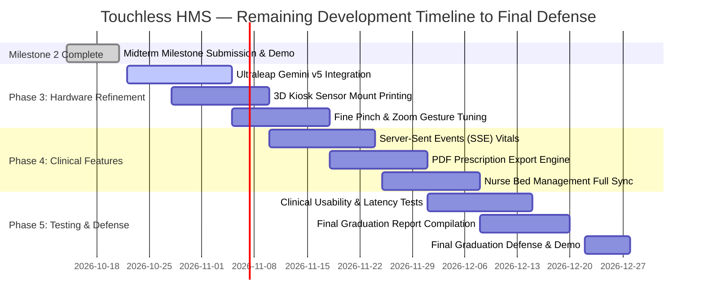

1. **Hardware & Tracking Optimization (Weeks 9–10):**
   * Finalize integration of the Ultraleap Gemini v5 hand tracking runtime with Mr. Anas.
   * Calibrate optical interaction field boundaries ($100\text{ mm} \le Z \le 400\text{ mm}$) to ignore background ambient motion.
2. **Clinical Subsystem Completion (Weeks 11–12):**
   * Implement real-time vital telemetry broadcasting via SSE in the nurse workstation.
   * Complete MOH-compliant PDF e-prescription rendering.
3. **Usability Evaluation & Final Defense Preparation (Weeks 13–15):**
   * Conduct quantitative user testing measuring task completion time, dwell accuracy, and error rates comparing touchless interaction against conventional touchscreen input.
   * Prepare final academic dissertation and demonstration setup.

---

## References

1. American University of the Middle East (AUM). (2026). *Senior Graduation Project Handbook and Guidelines*. College of Engineering and Technology, Kuwait.
2. World Health Organization (WHO). (2022). *Global report on infection prevention and control*. World Health Organization. https://www.who.int/publications/i/item/9789240051164
3. Ultraleap. (2024). *Leap Motion Controller Documentation & Gemini Tracking Architecture*. Ultraleap Developer Portal. https://docs.ultraleap.com
4. Pressman, R. S., & Maxim, B. R. (2020). *Software engineering: A practitioner's approach* (9th ed.). McGraw-Hill Education.
5. Elmasri, R., & Navathe, S. B. (2021). *Fundamentals of database systems* (7th ed.). Pearson.
6. Mozilla Developer Network (MDN). (2026). *Web Audio API & WebSocket Documentation*. MDN Web Docs. https://developer.mozilla.org
