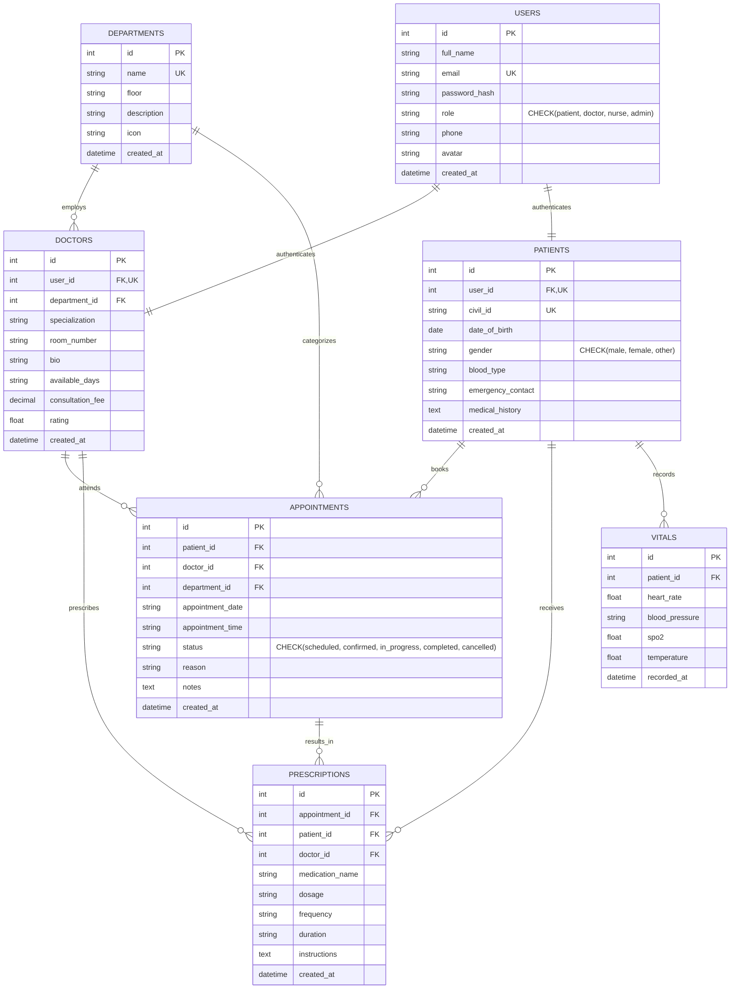

# Touchless Hospital Management System (Touchless HMS)
## Relational Database Schema & System Architecture Documentation

**Author:** Dana Alghareb  
**Institution:** Kuwait University — Graduation Project  
**Academic Advisor:** Week 4 Milestone Report  
**Leap Motion Integration Advisor:** Mr. Anas  

---

## 1. Executive Summary & Architecture Overview

The Touchless Hospital Management System (Touchless HMS) is a modern healthcare platform engineered to eliminate physical touchscreen contact in clinical and patient environments to prevent hospital-acquired infections (HAIs).

The system consists of:
1. **Touchless Patient Appointment Kiosk (`dashboard-patient.html`)**: Interactive hands-free kiosk where patients register, search specialist doctors by department, and book appointments using Leap Motion gestures (dwell selection, swipe navigation, and push-tap confirmation).
2. **Doctor Clinical Workstation (`dashboard-doctor.html`)**: Comprehensive clinical dashboard showing real-time scheduled appointments, patient history, vital signs monitoring, and prescription management.
3. **Nurse Ward Station (`dashboard-nurse.html`)**: Real-time vital sign alerts, bed allocation map, and touchless alarm acknowledgement.
4. **Backend REST API Engine (`server.js`)**: High-performance Node.js service providing secure authentication, appointment lifecycle management, doctor directory filtering, and dynamic patient vitals logging.
5. **Relational Database (`database/touchless_hms.db` / `database/schema.sql`)**: Fully normalized ANSI SQL database with strict Foreign Key integrity, constraints, indexes, and comprehensive audit timestamps.

---

## 2. Entity-Relationship (ER) Diagram

Per the supervisor's Week 4 feedback, the database has been restructured to ensure that every entity is properly linked via relational foreign keys. Most critically, the **`appointments`** entity now strictly links `patient_id` $\rightarrow$ `patients(id)`, `doctor_id` $\rightarrow$ `doctors(id)`, and `department_id` $\rightarrow$ `departments(id)`.



---

## 3. Database Schema Specification

### 3.1 Table: `departments`
Stores clinical departments and wards within the hospital.

| Column | Data Type | Constraints | Description |
|---|---|---|---|
| `id` | `INTEGER` | `PRIMARY KEY AUTOINCREMENT` | Unique department identifier |
| `name` | `TEXT` | `NOT NULL UNIQUE` | Official department name (e.g., Cardiology) |
| `floor` | `TEXT` | `NOT NULL` | Floor location (e.g., Floor 3) |
| `description` | `TEXT` | `NULL` | Department clinical scope |
| `icon` | `TEXT` | `DEFAULT '🏥'` | UI emoji or icon symbol |
| `created_at` | `DATETIME` | `DEFAULT CURRENT_TIMESTAMP` | Record creation timestamp |

### 3.2 Table: `users`
Central authentication and identity table for all actors (Patients, Doctors, Nurses, Admins).

| Column | Data Type | Constraints | Description |
|---|---|---|---|
| `id` | `INTEGER` | `PRIMARY KEY AUTOINCREMENT` | Unique user identifier |
| `full_name` | `TEXT` | `NOT NULL` | User's full formal name |
| `email` | `TEXT` | `NOT NULL UNIQUE` | Unique email for authentication |
| `password_hash` | `TEXT` | `NOT NULL` | Authentication credential hash |
| `role` | `TEXT` | `NOT NULL CHECK(role IN ('patient', 'doctor', 'nurse', 'admin'))` | System access role |
| `phone` | `TEXT` | `NULL` | Contact phone number |
| `avatar` | `TEXT` | `DEFAULT '👤'` | Profile avatar emoji/icon |
| `created_at` | `DATETIME` | `DEFAULT CURRENT_TIMESTAMP` | Registration timestamp |

### 3.3 Table: `doctors`
Extended profile for clinical medical staff, linked directly to `users` and `departments`.

| Column | Data Type | Constraints | Description |
|---|---|---|---|
| `id` | `INTEGER` | `PRIMARY KEY AUTOINCREMENT` | Unique doctor record identifier |
| `user_id` | `INTEGER` | `NOT NULL UNIQUE, FK -> users(id) ON DELETE CASCADE` | Associated user identity |
| `department_id` | `INTEGER` | `NOT NULL, FK -> departments(id) ON DELETE RESTRICT` | Assigned department |
| `specialization` | `TEXT` | `NOT NULL` | Medical sub-specialty |
| `room_number` | `TEXT` | `NOT NULL` | Clinic / Consultation room |
| `bio` | `TEXT` | `NULL` | Professional biography and qualifications |
| `available_days`| `TEXT` | `DEFAULT 'Sun,Mon,Tue,Wed,Thu'` | Weekly working schedule |
| `consultation_fee` | `DECIMAL(10,2)` | `DEFAULT 30.00` | Consultation cost (KWD) |
| `rating` | `FLOAT` | `DEFAULT 5.0` | Average patient satisfaction rating |
| `created_at` | `DATETIME` | `DEFAULT CURRENT_TIMESTAMP` | Record creation timestamp |

### 3.4 Table: `patients`
Detailed medical and demographic profile for hospital patients.

| Column | Data Type | Constraints | Description |
|---|---|---|---|
| `id` | `INTEGER` | `PRIMARY KEY AUTOINCREMENT` | Unique patient record identifier |
| `user_id` | `INTEGER` | `NOT NULL UNIQUE, FK -> users(id) ON DELETE CASCADE` | Associated user identity |
| `civil_id` | `TEXT` | `UNIQUE, NULL` | Kuwait Civil Identification Number |
| `date_of_birth`| `DATE` | `NULL` | Patient date of birth |
| `gender` | `TEXT` | `CHECK(gender IN ('male', 'female', 'other'))` | Patient gender |
| `blood_type` | `TEXT` | `DEFAULT 'O+'` | Blood group (e.g., A+, O-, B+) |
| `emergency_contact` | `TEXT` | `NULL` | Emergency contact person and phone |
| `medical_history` | `TEXT` | `NULL` | Chronic conditions and allergies |
| `created_at` | `DATETIME` | `DEFAULT CURRENT_TIMESTAMP` | Record creation timestamp |

### 3.5 Table: `appointments`
**Central entity resolving the supervisor's Week 4 feedback.** Explicitly links patients, doctors, and departments via relational foreign keys.

| Column | Data Type | Constraints | Description |
|---|---|---|---|
| `id` | `INTEGER` | `PRIMARY KEY AUTOINCREMENT` | Unique appointment identifier |
| `patient_id` | `INTEGER` | `NOT NULL, FK -> patients(id) ON DELETE CASCADE` | Booked patient |
| `doctor_id` | `INTEGER` | `NOT NULL, FK -> doctors(id) ON DELETE RESTRICT` | Scheduled doctor |
| `department_id` | `INTEGER` | `NOT NULL, FK -> departments(id) ON DELETE RESTRICT` | Clinical department |
| `appointment_date` | `TEXT` | `NOT NULL` | Appointment calendar date (`YYYY-MM-DD`) |
| `appointment_time` | `TEXT` | `NOT NULL` | Appointment time slot (`HH:MM`) |
| `status` | `TEXT` | `DEFAULT 'scheduled' CHECK(status IN ('scheduled', 'confirmed', 'in_progress', 'completed', 'cancelled'))` | Clinical workflow status |
| `reason` | `TEXT` | `NOT NULL` | Chief medical complaint / visit purpose |
| `notes` | `TEXT` | `NULL` | Doctor consultation remarks |
| `created_at` | `DATETIME` | `DEFAULT CURRENT_TIMESTAMP` | Booking timestamp |

### 3.6 Table: `prescriptions`
Medication orders issued by doctors during or following an appointment.

| Column | Data Type | Constraints | Description |
|---|---|---|---|
| `id` | `INTEGER` | `PRIMARY KEY AUTOINCREMENT` | Unique prescription identifier |
| `appointment_id` | `INTEGER` | `NULL, FK -> appointments(id) ON DELETE SET NULL` | Related consultation visit |
| `patient_id` | `INTEGER` | `NOT NULL, FK -> patients(id) ON DELETE CASCADE` | Prescribed patient |
| `doctor_id` | `INTEGER` | `NOT NULL, FK -> doctors(id) ON DELETE RESTRICT` | Prescribing physician |
| `medication_name` | `TEXT` | `NOT NULL` | Drug brand/generic name |
| `dosage` | `TEXT` | `NOT NULL` | Quantity and unit (e.g., 5mg) |
| `frequency` | `TEXT` | `NOT NULL` | Intake frequency (e.g., Twice daily) |
| `duration` | `TEXT` | `NOT NULL` | Course length (e.g., 30 days) |
| `instructions`| `TEXT` | `NULL` | Clinical instructions (e.g., After meals) |
| `created_at` | `DATETIME` | `DEFAULT CURRENT_TIMESTAMP` | Issuance timestamp |

### 3.7 Table: `vitals`
Historical vital sign observations monitored via ward displays or touchless telemetry.

| Column | Data Type | Constraints | Description |
|---|---|---|---|
| `id` | `INTEGER` | `PRIMARY KEY AUTOINCREMENT` | Unique measurement identifier |
| `patient_id` | `INTEGER` | `NOT NULL, FK -> patients(id) ON DELETE CASCADE` | Observed patient |
| `heart_rate` | `FLOAT` | `NOT NULL` | Heart Rate (Beats Per Minute) |
| `blood_pressure` | `TEXT` | `NOT NULL` | Systolic / Diastolic (mmHg) |
| `spo2` | `FLOAT` | `NOT NULL` | Blood Oxygen Saturation (%) |
| `temperature` | `FLOAT` | `NOT NULL` | Body Temperature (°C) |
| `recorded_at`| `DATETIME` | `DEFAULT CURRENT_TIMESTAMP` | Measurement timestamp |

---

## 4. Key SQL Queries & Relational Operations

### 4.1 Doctor Schedule Query (with Joined Patient & Department)
```sql
SELECT 
    a.id AS appointment_id,
    a.appointment_date,
    a.appointment_time,
    a.status,
    a.reason,
    pu.full_name AS patient_name,
    pu.phone AS patient_phone,
    pt.blood_type AS patient_blood,
    doc_u.full_name AS doctor_name,
    doc.specialization,
    doc.room_number,
    dep.name AS department_name
FROM appointments a
JOIN patients pt ON a.patient_id = pt.id
JOIN users pu ON pt.user_id = pu.id
JOIN doctors doc ON a.doctor_id = doc.id
JOIN users doc_u ON doc.user_id = doc_u.id
JOIN departments dep ON a.department_id = dep.id
WHERE a.doctor_id = 1 AND a.appointment_date >= CURRENT_DATE
ORDER BY a.appointment_date ASC, a.appointment_time ASC;
```

### 4.2 Dynamic Doctor Search by Department & Keyword
```sql
SELECT 
    doc.id AS doctor_id,
    u.full_name,
    doc.specialization,
    doc.room_number,
    doc.consultation_fee,
    doc.rating,
    dep.name AS department_name,
    dep.floor AS department_floor
FROM doctors doc
JOIN users u ON doc.user_id = u.id
JOIN departments dep ON doc.department_id = dep.id
WHERE (? IS NULL OR doc.department_id = ?)
  AND (? IS NULL OR (LOWER(u.full_name) LIKE ? OR LOWER(doc.specialization) LIKE ?))
ORDER BY doc.rating DESC;
```

### 4.3 Safe Appointment Insertion with Integrity Validation
```sql
INSERT INTO appointments (
    patient_id, 
    doctor_id, 
    department_id, 
    appointment_date, 
    appointment_time, 
    status, 
    reason, 
    notes
) VALUES (?, ?, ?, ?, ?, 'scheduled', ?, ?);
```

---

## 5. Leap Motion Meeting Guide (For Sessions with Mr. Anas)

### 5.1 Meeting Times
- **Session 1:** Tuesday at 11:00 AM
- **Session 2:** Wednesday at 10:00 AM

### 5.2 Device & Driver Configuration Checklist
1. **Hardware:** Connect the **Leap Motion Controller (LM-010)** via USB 3.0 / USB 2.0 port.
2. **Service Verification:** Ensure the Ultraleap / Leap Motion service is running in Windows:
   - Run `services.msc` and verify `Leap Service` (`LeapSvc.exe`) is **Running**.
   - Check the green icon in the system tray (`Leap Control Panel`).
3. **WebSockets Permission:** Open **Leap Motion Control Panel** $\rightarrow$ **Troubleshooting / General** $\rightarrow$ Ensure **"Allow Web Apps"** is checked.
4. **WebSocket Port:**
   - Ultraleap V2/V4 WebSocket streams at `ws://127.0.0.1:6437/v6.json` (unencrypted) and `wss://127.0.0.1:6436` (secure).
   - Our `js/leap-gesture.js` script handles automatic handshake, exponential reconnect, and protocol fallback.

### 5.3 Live Demonstration Screen: Patient Appointment Kiosk
The **Patient Appointment Kiosk (`dashboard-patient.html`)** is ready for live hands-free evaluation:
- **Cursor Tracking:** Position hand 15–30 cm above the controller; the circular pointer tracks screen coordinates in real time with Exponential Moving Average (EMA) smoothing.
- **Dwell Selection:** Hovering over any doctor card, time slot, or button for 1.2s fills the circular progress ring and triggers an automated touchless click.
- **Gesture Swiping:** Swiping hand horizontally navigates specialist doctors and department categories hands-free.
- **Push-Tap Detection:** Quick forward finger jab triggers a direct selection event.
- **Status Indicator:** Floating badge at the bottom-right corner displays `🟢 CONNECTED — LEAP MOTION LM-010` with live FPS telemetry and hand count.

---

## 6. Zero-Dependency Deployment Instruction (Node.js & SQLite)

To launch the system using Node.js and embedded SQLite:
1. Ensure Node.js (v22+) is installed.
2. Double-click **`start-touchless-hms.bat`**.
3. The server automatically launches on `http://localhost:3000` and opens the Patient Appointment Kiosk in the default browser.

---

## 7. PHP & MySQL Deployment Instruction (XAMPP & phpMyAdmin)

If your academic supervisor explicitly requires a **PHP and MySQL (phpMyAdmin)** stack:
1. **Start XAMPP:**
   - Open **XAMPP Control Panel** (`C:\xampp2\xampp-control.exe`).
   - Click **Start** on **Apache** and **MySQL**.
2. **Import MySQL Database:**
   - Open your browser to `http://localhost/phpmyadmin`.
   - Click the **Import** tab.
   - Choose the file: `database/touchless_hms_mysql.sql`.
   - Click **Import** (or **Go**).
   - This creates the `touchless_hms` database with all tables, constraints, foreign keys (`patient_id`, `doctor_id`, `department_id`), and Kuwait hospital seed data!
3. **Launch PHP Server:**
   - Double-click **`start-php-backend.bat`**.
   - It automatically starts the PHP 8.4 REST API engine on `http://localhost:3000` connected to MySQL via PDO.
   - All bookings, registrations, and logins save directly into MySQL and are visible in phpMyAdmin!

